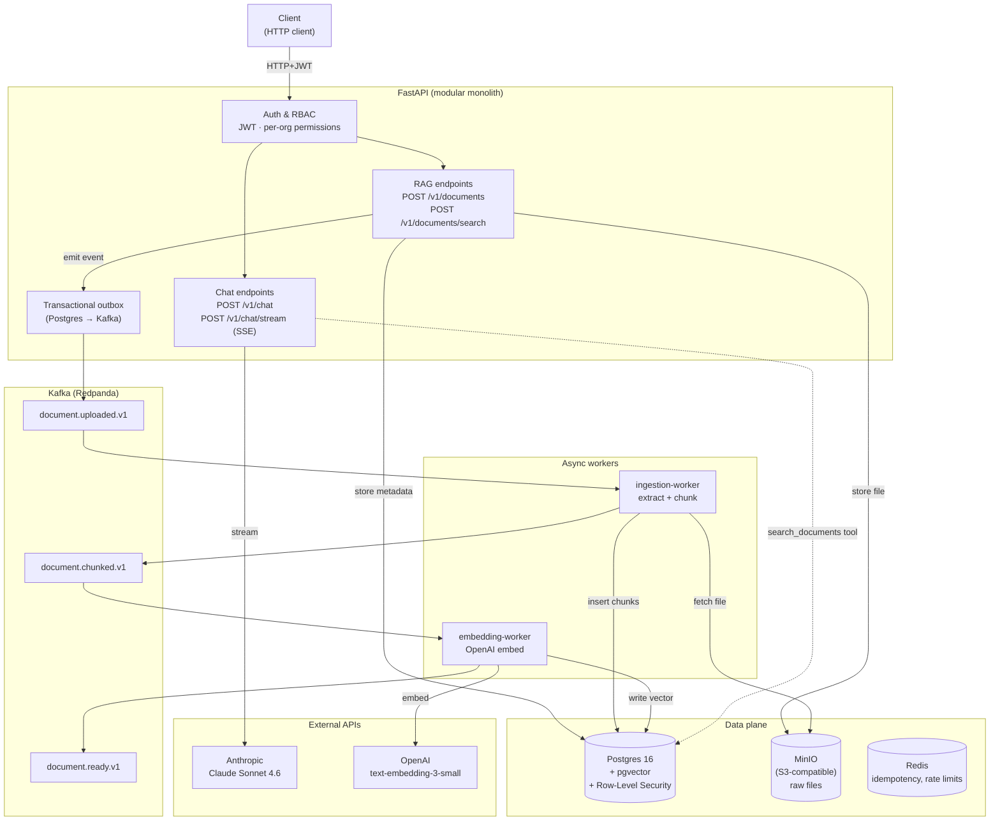

# Enterprise AI Workflow Platform

[](https://github.com/Anne07-Ai/enterprise-ai-platform/actions/workflows/ci.yml)
[](https://opensource.org/licenses/Apache-2.0)
[](https://www.python.org/downloads/)

A self-hostable reference implementation of a multi-tenant API for document
ingestion, vector retrieval and tool-using chat.

## Implementation status

| Area | Status in this checkout |
| --- | --- |
| Identity | Email/password login, signed access tokens, refresh tokens, API keys and organization roles are implemented. |
| Tenant isolation | Transaction-local PostgreSQL settings and RLS policies are implemented. The effective database role and live isolation tests determine whether those policies enforce the boundary. See [Known Issues](KNOWN_ISSUES.md). |
| Documents | S3-compatible uploads, a PostgreSQL outbox, Kafka ingestion and embedding workers, and pgvector search are implemented. |
| Chat | Synchronous and SSE endpoints use an in-process Anthropic tool loop with document retrieval. |
| Operations | Local Compose and observability configuration are available. See [Roadmap](ROADMAP.md) for the remaining deployment and verification work. |

Here, **implemented** means the code path exists. [Known Issues](KNOWN_ISSUES.md)
records which checks ran and where verification is still pending.

## Architecture



See [Architecture](ARCHITECTURE.md) for service boundaries and verification
limits.

## Tech stack

| Layer         | Choice                                                                          |
| ------------- | ------------------------------------------------------------------------------- |
| API           | FastAPI · Python 3.12 · Pydantic v2 · uv                                        |
| Auth          | JWT (RS256) · per-org RBAC · API keys                                           |
| Data          | Postgres 16 + pgvector · Redis 7 · MinIO (S3-compatible)                        |
| Async         | Redpanda (Kafka API) · transactional outbox · idempotent consumers              |
| AI            | Anthropic Claude Sonnet 4.6 (chat) · OpenAI text-embedding-3-small (embeddings) |
| Observability | OpenTelemetry → Prometheus · Loki · Tempo · Grafana                             |
| Dev infra     | Docker Compose · Colima or Docker Desktop                                |

## Running locally

Local development uses Docker (Colima or Docker Desktop), Python 3.12 and
`uv`. Provider-backed chat and embedding calls require their corresponding
API keys.

```bash
git clone https://github.com/Anne07-Ai/enterprise-ai-platform.git
cd enterprise-ai-platform
cp .env.example .env
# edit .env to add EAIP_ANTHROPIC_API_KEY and EAIP_OPENAI_API_KEY

make up
make healthcheck
```

Boots the full local infrastructure plane (Postgres+pgvector, Redis,
Redpanda, MinIO, OTel collector, Prometheus, Loki, Tempo, Grafana) and
runs the infrastructure health checks.

Complete the [local PostgreSQL role setup](docs/database-roles.md) before
starting the API and workers. Run migrations with the schema-owner login
and use the restricted runtime login for the API, workers and demo seed.

Start the API and workers in separate terminals.

```bash
# Terminal A — ingestion worker
cd apps/api && set -a; source ../../.env; set +a
uv run python -m app.workers.ingestion

# Terminal B — embedding worker
cd apps/api && set -a; source ../../.env; set +a
uv run python -m app.workers.embedding

# Terminal C — API server
cd apps/api && set -a; source ../../.env; set +a
uv run uvicorn app.main:app --port 8000
```

The demo seed creates a local fixture. See the
[login validation issue](KNOWN_ISSUES.md#identity-caveats) before using
it for an HTTP login test.

```bash
cd apps/api && set -a; source ../../.env; set +a
EAIP_SEED_DEMO=1 uv run python -m app.scripts.seed
```

## API surface

| Endpoint                       | Auth                 | Description                                  |
| ------------------------------ | -------------------- | -------------------------------------------- |
| `POST /v1/auth/login`          | —                    | Email + password → JWT access/refresh tokens |
| `POST /v1/documents`           | User-bound principal | Multipart upload, queues async ingestion     |
| `GET /v1/documents/{id}`       | Authorized principal | Fetch document metadata + status             |
| `POST /v1/documents/search`    | Authorized principal | Semantic search over the org's chunks        |
| `POST /v1/chat`                | User-bound principal | One-shot tool-using agent turn (JSON)        |
| `POST /v1/chat/stream`         | User-bound principal | Same agent, SSE-streamed events              |
| `GET /healthz` / `GET /readyz` | —                    | Liveness and readiness probes                |

OpenAPI is available at `GET /openapi.json`. See the
[identity caveats](KNOWN_ISSUES.md#identity-caveats) for current API-key
permission behavior.

## Design decisions

See the [ADR index](docs/adr/README.md) for the design history,
[ADR-006](docs/adr/006-rag-ingestion-pipeline.md) for document ingestion, and
[ADR-0007](docs/adr/0007-no-langgraph-direct-react-loop.md) for the direct agent
loop.

## Roadmap

See [Roadmap](ROADMAP.md) for implementation status and upcoming work.

## License

Apache 2.0. See [LICENSE](LICENSE).
